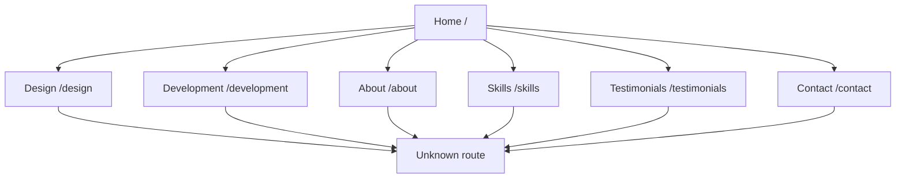
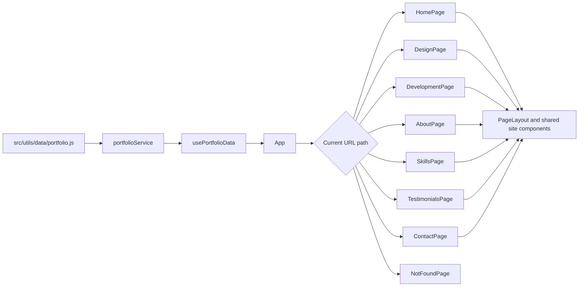

# Muhammad Hadi — Designer & Developer

A personal portfolio for **Muhammad Hadi**, a digital solutions engineer and designer based in Rawalpindi, Pakistan. The site brings visual design and full-stack development work together in one responsive experience.

It is built with React and Vite, styled with Tailwind CSS, and deployed to Netlify.

## Portfolio at a glance

- **Design:** branding, logo and visual identity, UI/UX, posters, packaging, illustration, and marketing materials.
- **Development:** MERN stack applications, REST APIs, authentication, database integration, responsive interfaces, and performance-focused engineering.
- **Selected work:** design case studies and development projects, including Cheqnovex, a SaaS application, and DRIVEXA.
- **More about Hadi:** background, skills, career journey, testimonials, and contact details.

## Pages

| Route           | Description                                                                |
| --------------- | -------------------------------------------------------------------------- |
| `/`             | Introduction, design and development highlights, and experience statistics |
| `/design`       | Design services and selected design projects                               |
| `/development`  | Development services and featured application projects                     |
| `/about`        | Background, education, and career timeline                                 |
| `/skills`       | Design and development skill sets                                          |
| `/testimonials` | Client and collaborator testimonials                                       |
| `/contact`      | Contact details and enquiry form                                           |

### Navigation map



## Built with

- **React 19** for the component-based user interface
- **Vite 8** for local development and production builds
- **Tailwind CSS 4** for styling
- **Lucide React** for interface icons
- **React Simple Typewriter** for animated role text
- **Netlify** for hosting and single-page application routing

## Run locally

### Requirements

- Node.js and npm

### Setup

```bash
git clone https://github.com/alihadipro90-sys/My-Portfolio.git
cd My-Portfolio
npm install
npm run dev
```

Vite prints the local development URL in the terminal after the server starts.

## Available commands

| Command             | Description                            |
| ------------------- | -------------------------------------- |
| `npm run dev`       | Start the Vite development server      |
| `npm run build`     | Create the production build in `dist/` |
| `npm run build:dev` | Create a development-mode build        |
| `npm run preview`   | Preview the production build locally   |
| `npm run lint`      | Run ESLint                             |

## How the app works

The portfolio content is kept in a local JavaScript data module. The app loads it through a small service and React hook, then selects a page using the current URL path. Navigation updates browser history, while the Netlify redirect sends direct route requests back to the single-page app.



## Project structure

```text
.
├── public/                 # Public assets served as-is
├── src/
│   ├── assets/             # Images, icons, and resume PDFs
│   ├── components/site/    # Shared navigation, layout, and UI components
│   ├── hooks/              # React hooks, including portfolio data loading
│   ├── pages/              # Route-level page components
│   ├── services/           # Portfolio data service
│   ├── utils/data/         # Portfolio content and project data
│   ├── App.jsx             # Route selection and navigation
│   ├── main.jsx            # React entry point
│   └── styles.css          # Global styles and Tailwind entry point
├── index.html
├── netlify.toml            # Build, SPA redirect, and response headers
└── package.json
```

## Updating portfolio content

- Edit profile details, services, skills, timeline entries, and project descriptions in [`src/utils/data/portfolio.js`](src/utils/data/portfolio.js).
- Add or replace images and resume files under `src/assets/` or `public/`, then update the matching imports or paths.
- Update testimonial copy in [`src/pages/TestimonialsPage.jsx`](src/pages/TestimonialsPage.jsx); testimonials currently live in that page rather than the portfolio data module.
- Update route definitions in [`src/App.jsx`](src/App.jsx) when adding or removing pages.

## Deployment

The repository includes a Netlify configuration. Create a Netlify site connected to the repository and use:

- **Build command:** `npm run build`
- **Publish directory:** `dist`

The Netlify configuration also includes a fallback redirect for client-side routes and security/cache headers.

## Contact

- **Email:** [alihadipro90@gmail.com](mailto:alihadipro90@gmail.com)
- **Location:** Rawalpindi, Pakistan

> **Contact form note:** The contact page currently validates fields in the browser and displays a confirmation message, but it does not send or store submissions. Connect it to a backend or form service before using it to receive enquiries.
